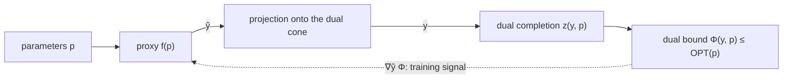

# L2ODLL.jl

[](https://github.com/LearningToOptimize/L2ODLL.jl/actions/workflows/CI.yml?query=branch%3Amain)
[](https://app.codecov.io/gh/LearningToOptimize/L2ODLL.jl)
[](https://learningtooptimize.github.io/L2ODLL.jl/dev/)
[](https://learningtooptimize.github.io/L2ODLL.jl/stable/)

L2ODLL is a Julia package implementing [Dual Lagrangian Learning for Conic Optimization](https://arxiv.org/abs/2402.03086) (DLL) using the [JuMP](https://github.com/jump-dev/JuMP.jl) modeling language.
A proxy (e.g. a neural network) predicts some dual variables of a parametric conic or convex quadratic problem; L2ODLL projects the prediction onto the dual cone and completes the remaining dual variables in closed form, so that the result is dual feasible. Its dual objective is then a **valid bound on the optimal value for every prediction**, and it is differentiable, so it doubles as a self-supervised training loss that needs no optimal solutions.
You write only the *primal* JuMP model: L2ODLL dualizes it ([Dualization.jl](https://github.com/jump-dev/Dualization.jl)), detects a decomposition with a closed-form completion and builds the projection, completion, bound and gradient functions.



## Installation

```julia
import Pkg
Pkg.add(; url = "https://github.com/LearningToOptimize/L2ODLL.jl")
```

## Example

```julia
using JuMP, L2ODLL

model = Model()
@variable(model, 0 <= x[1:2] <= 1)
@variable(model, d in MOI.Parameter(1.0))          # parameter: the demand
@constraint(model, balance, x[1] + x[2] == d)
@objective(model, Min, x[1] + 3x[2])

decompose!(model)                                   # detects BoundDecomposition

dual_objective(model, [[2.0]], [1.5])               # 2.0 ≤ OPT(1.5) = 2.5, for any prediction
dual_objective(model, [[3.0]], [1.5])               # 2.5: the optimal price gives the optimum
dual_objective_gradient(model, [[2.0]], [1.5])      # training signal

Y = randn(sum(y_shape(model)), 64)                  # batch: predictions × instances
P = 1 .+ rand(1, 64)                                # parameters × instances
bounds, G = dual_objective_and_gradient(model, Y, P)
```

See the [economic dispatch example](https://learningtooptimize.github.io/L2ODLL.jl/dev/examples/economic_dispatch/) for training a proxy.

## What you need to provide

- A JuMP model whose problem data that changes between instances are **parameters**
  (`@variable(model, p in MOI.Parameter(value))`), entering the constraint constants
  and the linear objective coefficients.
- A problem with a closed-form completion: **every variable bounded** with an
  objective affine in the variables (any cones in the constraints), or a **strictly
  convex quadratic objective** (positive definite Hessian; negative definite for
  `Max`). Other
  problems work with a hand-built `GenericDecomposition` and a solver for the
  completion.
- A proxy producing `sum(y_shape(model))` outputs per instance, in any Julia ML
  framework (gradients work with ForwardDiff and Zygote).

## Guarantees

Under these assumptions, for every prediction the completed point is dual feasible
and `dual_objective` is a valid bound (Theorems 1–2 of the DLL paper); completing
the optimal duals recovers the optimal value. Each claim is checked numerically in
the tests on random instances; see the
[Theory page](https://learningtooptimize.github.io/L2ODLL.jl/dev/theory/).

## LearningToOptimize ecosystem

L2ODLL implements the method interface of `L2OCore`
([LearningToOptimize.jl](https://github.com/LearningToOptimize/LearningToOptimize.jl))
as a dual method with guarantee `ValidDualBound` (`import L2OCore` loads it;
`L2ODLL.DLLMethod()`), so it can be used, compared and evaluated in the same
pipeline as the primal methods of the ecosystem. Related packages:
[LearningToOptimize.jl](https://github.com/LearningToOptimize/LearningToOptimize.jl),
[DecisionRules.jl](https://github.com/LearningToOptimize/DecisionRules.jl).

## Citation

If you use L2ODLL, please cite the DLL paper (and the interior-point follow-up if you
use the smoothed bounded completion); see also [`CITATION.cff`](CITATION.cff).

```bibtex
@inproceedings{tanneau2024dual,
  title     = {Dual Lagrangian Learning for Conic Optimization},
  author    = {Tanneau, Mathieu and Van Hentenryck, Pascal},
  booktitle = {Advances in Neural Information Processing Systems},
  year      = {2024},
  note      = {arXiv:2402.03086}
}
@article{klamkin2024dual,
  title   = {Dual Interior Point Optimization Learning},
  author  = {Klamkin, Michael and Tanneau, Mathieu and Van Hentenryck, Pascal},
  journal = {arXiv preprint arXiv:2402.02596},
  year    = {2024}
}
```
