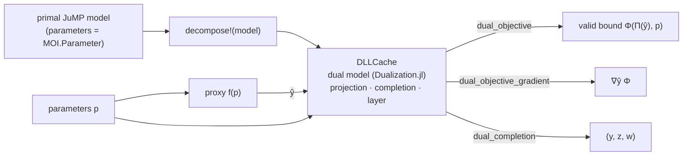

# Package guide

```@meta
CurrentModule = L2ODLL
```

L2ODLL takes a **primal** parametric JuMP model and builds, once, everything Dual
Lagrangian Learning needs during training and inference:



## Getting started

```jldoctest guide
julia> using JuMP, L2ODLL

julia> model = Model();

julia> @variable(model, 0 <= x[1:2] <= 1);

julia> @variable(model, d in MOI.Parameter(1.0));    # parameter: the demand

julia> @constraint(model, balance, x[1] + x[2] == d);

julia> @objective(model, Min, x[1] + 3x[2]);

julia> cache = decompose!(model);                    # auto-detects BoundDecomposition

julia> cache.decomposition isa BoundDecomposition
true

julia> get_y(model)                                  # predicted: the balance constraint
1-element Vector{ConstraintRef}:
 balance : x[1] + x[2] - d = 0

julia> y_shape(model)
1-element Vector{Int64}:
 1

julia> dual_objective(model, [[2.0]], [1.5])          # Φ for y = 2 at d = 1.5
2.0

julia> dual_objective(model, [[3.0]], [1.5])          # the optimal price: tight bound
2.5
```

For ``d = 1.5`` the optimum is ``x = (1, 0.5)`` with cost ``2.5``; every ``y`` gives
a lower bound, and the marginal price ``y = 3`` gives the optimum.

## Concepts

- **Parameters** are the inputs of the proxy, in the order
  `filter(is_parameter, all_variables(model))`.
- **`y`** is a vector of vectors: one block per constraint in [`get_y`](@ref), of
  length [`y_shape`](@ref) (`1` for scalar constraints, the cone dimension for
  vector constraints). [`L2ODLL.flatten_y`](@ref) and [`L2ODLL.unflatten_y`](@ref)
  convert to and from a flat vector (the proxy output).
- **Signs** follow `JuMP.dual`: `JuMP.dual.(get_y(model))` after solving is a valid
  (optimal) prediction.
- **Batches** use matrices with the batch as the last dimension:
  `dual_objective(model, Y, P)` with `Y` of size `sum(y_shape(model)) × B` and `P`
  of size `num_parameters × B`; [`dual_objective_gradient`](@ref) and
  [`dual_objective_and_gradient`](@ref) have the same matrix forms.
- **Completion**: [`dual_completion`](@ref) returns the projected `y`, the completed
  `z` (one block per constraint in [`get_z`](@ref)) and the quadratic slacks `w`.
- **Differentiation** uses DifferentiationInterface.jl: pass any
  `ad_type` (default `AutoForwardDiff()`). The closed-form layers are plain array
  code, so reverse-mode backends such as Zygote also work.

## Decompositions

| decomposition | when | predicted ``y`` | completed | completion |
|:--|:--|:--|:--|:--|
| [`BoundDecomposition`](@ref) | every variable has finite bounds, objective affine in ``x`` | all constraints except bounds | bound duals ``z_l, z_u`` | closed form (Theory eq. 4) |
| [`ConvexQP`](@ref) | strictly convex objective (Hessian ``Q \succ 0``; ``\prec 0`` for `Max`) | all constraints | quadratic slacks ``w`` | closed form (Theory eq. 6) |
| [`GenericDecomposition`](@ref) | any; built by hand | the constraints you choose | the others | a solver (`optimizer`) |

See [Decompositions](../background/decompositions.md) and
[Decomposition detection](../background/decomposition_detection.md) for the
derivations.

## Extension points

### Custom decompositions

Choose the predicted constraints yourself and let a solver complete the rest:

```julia
import ParametricOptInterface as POI, HiGHS
d = GenericDecomposition(model, [balance])               # predict only `balance`
decompose!(model, d; optimizer = () -> POI.Optimizer(HiGHS.Optimizer()))
```

The completion problem (Theory eq. 3) is solved with the given optimizer each call;
the optimizer must support parameters (e.g. through ParametricOptInterface). The
completion may be infeasible for an arbitrary split (Theory, hypothesis of
Theorem 1); the call then throws.

A new decomposition **type** subtypes [`AbstractDecomposition`](@ref) with fields
`p_ref` and `y_ref`, implements [`completed_constraints`](@ref) (or has a `z_ref`
field) and, to take part in auto-detection, [`can_decompose`](@ref). A closed form
is supplied through the builders below.

### Custom projections

Any map into the dual cone keeps the bound valid, e.g. the radial projection of DLL
(eq. 26). Pass a function from `y` (vector of vectors) to projected `y`:

```julia
decompose!(model, BoundDecomposition(model); proj_fn = y -> my_projection.(y))
```

[`L2ODLL.make_jump_proj_fn`](@ref) builds a solver-based projection for cones without
a closed-form projection.

### Custom layers and completions

`dll_layer_builder(decomposition, proj_fn, dual_model)` must return
`(y_pred, param_value) -> Φ`, and `completion_builder` (same arguments) must return
`(y_pred, param_value) -> (y = ..., z = ..., w = ...)`. The built-in builders are
[`L2ODLL.bounded_builder`](@ref), [`L2ODLL.convex_qp_builder`](@ref),
[`L2ODLL.jump_builder`](@ref) and their `*_completion_builder` counterparts, e.g.
the smoothed log-barrier completion:

```julia
decompose!(model, BoundDecomposition(model);
    dll_layer_builder = (d, proj, dm) -> L2ODLL.bounded_builder(d, proj, dm; completion = :log, μ = 0.1),
    completion_builder = (d, proj, dm) -> L2ODLL.bounded_completion_builder(d, proj, dm; completion = :log, μ = 0.1))
```

### As an L2OCore method

[`DLLMethod`](@ref) plugs L2ODLL into the method-agnostic LearningToOptimize
pipeline; see [L2OCore interface](l2ocore.md).
