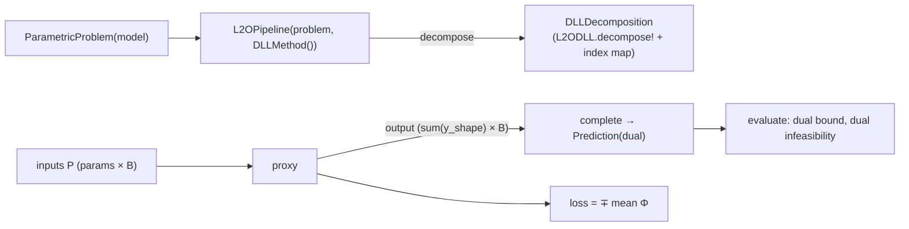

# L2OCore interface and design notes

```@meta
CurrentModule = L2ODLL
```

[L2OCore](https://github.com/LearningToOptimize/LearningToOptimize.jl) (in
`lib/L2OCore` of LearningToOptimize.jl) defines a small, method-agnostic pipeline
shared by the Learning-to-Optimize packages: a `ParametricProblem`, methods that
declare which problem classes they `supports`, and the steps
`decompose → generate_data → loss → complete → evaluate`.
L2ODLL implements it as a **dual method**.



| L2OCore function | DLL implementation |
|:--|:--|
| `supports` | `LinearConic`, `ConvexQuadratic` |
| `decompose` | [`decompose!`](@ref) (auto-detected, or `DLLMethod(decomposition = BoundDecomposition)`) |
| `output_dimension` | `sum(y_shape(model))` |
| `complete` | projection + completion; full dual in `dual_layout` order with `JuMP.dual` signs |
| `loss` | self-supervised (Theory eq. 7): ``-\text{mean}\,\Phi`` (min) / ``+\text{mean}\,\Phi`` (max) |
| `generate_data` | inputs only; with `optimizer`, also optimal objectives and duals (for gaps) |

```julia
import L2OCore, L2ODLL, Clarabel
problem = L2OCore.ParametricProblem(model)
pipe = L2OCore.L2OPipeline(problem, L2ODLL.DLLMethod())
data = L2OCore.generate_data(pipe; sampler = L2OCore.BoxSampler(lo, hi), n = 100,
                             optimizer = Clarabel.Optimizer)       # solver optima for gaps
Y = proxy(data.inputs)                                              # sum(y_shape) × 100
ℓ = L2OCore.loss(pipe, data.inputs, Y)                              # minimize this
pred = L2OCore.complete(pipe, data.inputs, Y)
report = L2OCore.evaluate(problem, data.inputs, pred)             # dual bound, dual infeasibility
gap = (data.objective .- report.dual_bound) ./ max.(1, abs.(data.objective))
```

The [economic dispatch example](../examples/economic_dispatch.md) runs this end to end.

## Why a package extension

L2OCore adds no new transitive dependencies (it uses JuMP, MathOptInterface and
standard libraries, all already dependencies of L2ODLL), so weight is not the
concern. It is, however, not registered yet and is installed from a branch. Making
it a hard dependency would make every installation and every CI run of L2ODLL
depend on that branch. As a weak dependency:

- `using L2ODLL` works and is tested without L2OCore;
- `import L2OCore` loads the extension `L2ODLLL2OCoreExt`, which defines the method
  type; [`DLLMethod`](@ref) is its constructor (calling it without L2OCore loaded
  prints a hint);
- once L2OCore is registered, the `[sources]` entry and the CI step for Julia 1.10
  can be dropped; the extension can stay.

## Automatic differentiation

DLL's loss needs only **first-order** derivatives of ``\Phi`` with respect to the
proxy output (then the chain rule through the proxy), so it does not need nested AD.

| backend | through `dual_objective` / `L2OCore.loss` | tested against |
|:--|:--|:--|
| ForwardDiff | yes (default `ad_type`) | central finite differences |
| Zygote | yes | ForwardDiff, to ``10^{-10}`` |
| FiniteDifferences / other DI backends | yes, via `ad_type` | — |
| solver-based layers (`jump_builder`) | no AD; gradients would need the dual of the completion (issue #5) | — |

Consequently any Julia ML framework whose training loop uses Zygote (Flux, Lux)
can train a DLL proxy: the proxy is just a callable mapping parameters to the
`sum(y_shape) × B` output.

## GPU and batching

The closed-form layers are matrix expressions (`QuadExprMatrix`,
`VecAffExprMatrix`; `Adapt`-compatible, with a `backend` hook for the array type,
of which only the CPU backend is defined so far) evaluated per instance. The batched matrix API currently loops over
columns on the CPU. A fully batched layer, where ``Y`` and ``P`` are device matrices
and the completion (Theory eqs. 4–6) is a few dense or sparse matrix products and
elementwise operations, is the natural next step; it fits the ExaModels /
BatchNLPKernels evaluation path planned in L2OCore. Projections onto cones other
than the nonnegative orthant and the second-order cone would need batched kernels
as well.
