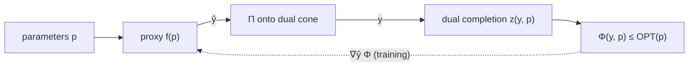

# L2ODLL.jl

L2ODLL.jl implements **Dual Lagrangian Learning** (DLL) of
[Tanneau and Van Hentenryck (2024)](https://arxiv.org/abs/2402.03086) for parametric
conic and convex quadratic problems modeled in [JuMP](https://jump.dev), with the
bounded-variable completions of
[Klamkin, Tanneau and Van Hentenryck](https://arxiv.org/abs/2402.02596).

A neural network (or any proxy) predicts some of the dual variables ``\hat y`` of a
primal problem from its parameters ``p``. L2ODLL projects the prediction onto the
dual cone and **completes** the remaining dual variables so that the result is dual
feasible. Its dual objective is therefore a **valid bound** on the optimal value for
*every* prediction (weak duality), and it is differentiable in ``\hat y``, so it is
also the self-supervised training loss: maximizing it needs no optimal solutions.



L2ODLL takes the *primal* JuMP model, dualizes it with Dualization.jl, detects a
decomposition with a closed-form completion and builds the projection, completion,
bound and gradient functions automatically.

## Installation

```julia
import Pkg
Pkg.add(; url = "https://github.com/LearningToOptimize/L2ODLL.jl")
```

## Where to go next

- [Theory](theory.md): the optimization problems, the completions in closed form
  and their gradients, with equation numbers of the papers.
- [Package guide](guide/concepts.md): getting started, concepts, custom
  decompositions, projections and layers.
- [L2OCore interface](guide/l2ocore.md): using L2ODLL as a method of the
  LearningToOptimize pipeline; AD and GPU notes.
- Examples: [Markowitz portfolio](examples/markowitz.md),
  [economic dispatch](examples/economic_dispatch.md) (training a proxy).

## The LearningToOptimize ecosystem

| package | role |
|:--|:--|
| [LearningToOptimize.jl](https://github.com/LearningToOptimize/LearningToOptimize.jl) | shared interface (`L2OCore`), data generation, basic methods |
| **L2ODLL.jl** | dual methods: valid dual bounds by completion |
| [DecisionRules.jl](https://github.com/LearningToOptimize/DecisionRules.jl) | decision rules for multistage stochastic optimization |
