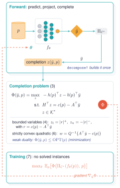

# L2ODLL.jl

```@raw html
<p class="eyebrow">Dual proxies · Dual completion · Lagrangian bounds</p>
<figure class="fig hero has-compact">
```
![Dual Lagrangian Learning. Forward: the proxy f_theta maps the parameters p to a predicted dual y-hat; it is projected onto the dual cone, y-bar equals Pi_C-star of y-hat; the completion z of y-bar and p solves the completion problem (3), Phi of y-bar and p equals the maximum over z of minus h of p transpose z minus b of p transpose y-bar, subject to H transpose z equals c of p minus A transpose y-bar and z in the dual cone K-star; closed forms exist for bounded variables (4) and strictly convex quadratic objectives (6); by weak duality Phi is at most OPT of p for minimization. Training (7): maximize the expected Phi over theta, with the gradient of Phi with respect to y-hat returned to theta; no solved instances are needed. decompose! builds the projection, the completion and Phi once from the primal JuMP model.](assets/diagrams/l2odll--dual-completion.svg)


```@raw html
<figcaption><i>The proxy predicts some dual variables; projection and completion make them dual feasible, so their dual objective is a bound on the optimal value and, maximized, the training loss.</i></figcaption>
</figure>
<p class="lede">L2ODLL.jl implements <b>Dual Lagrangian Learning</b> (DLL) of <a href="https://arxiv.org/abs/2402.03086">Tanneau and Van Hentenryck (2024)</a> for parametric conic and convex quadratic problems modeled in <a href="https://jump.dev">JuMP</a>, with the bounded-variable completions of <a href="https://arxiv.org/abs/2402.02596">Klamkin, Tanneau and Van Hentenryck</a>. A proxy predicts some of the dual variables from the parameters; projection onto the dual cone and completion of the remaining dual variables make the result dual feasible, so its dual objective is a bound on the optimal value for every prediction (weak duality) and, being differentiable, the self-supervised training loss.</p>
```

L2ODLL takes the *primal* JuMP model, dualizes it with Dualization.jl, detects a
decomposition with a closed-form completion and builds the projection, completion,
bound and gradient functions automatically.

## Installation

L2ODLL is not registered yet. Its optional `L2OCore` interface
([`L2ODLL.DLLMethod`](@ref)) comes from the development version of
LearningToOptimize.jl; the registered LearningToOptimize 1.0.0 predates it. Install
the core subpackage first, then L2ODLL, on any Julia version from 1.10:

```julia
import Pkg
Pkg.add(; url = "https://github.com/LearningToOptimize/LearningToOptimize.jl", subdir = "lib/L2OCore")
Pkg.add(; url = "https://github.com/LearningToOptimize/L2ODLL.jl")
Pkg.add("JuMP")   # used by every example
```

The examples also use HiGHS and Clarabel: `Pkg.add(["HiGHS", "Clarabel"])`.

## Example

```julia
using JuMP, L2ODLL

model = Model()
@variable(model, 0 <= x[1:2] <= 1)
@variable(model, d in MOI.Parameter(1.0))          # parameter: the demand
@constraint(model, balance, x[1] + x[2] == d)
@objective(model, Min, x[1] + 3x[2])

decompose!(model)                                   # detects BoundDecomposition

dual_objective(model, [[2.0]], [1.5])               # 2.0 ≤ OPT(1.5) = 2.5, for any prediction
dual_objective(model, [[3.0]], [1.5])               # 2.5: the optimal price gives the optimum
dual_objective_gradient(model, [[2.0]], [1.5])      # training signal

Y = randn(sum(y_shape(model)), 64)                  # batch: predictions × instances
P = 1 .+ rand(1, 64)                                # parameters × instances
bounds, G = dual_objective_and_gradient(model, Y, P)
```

## Where to go next

- [Theory](theory.md): the optimization problems, the completions in closed form
  and their gradients, with equation numbers of the papers.
- [Package guide](guide/concepts.md): getting started, concepts, custom
  decompositions, projections and layers.
- [L2OCore interface](guide/l2ocore.md): using L2ODLL as a method of the
  LearningToOptimize pipeline; AD and GPU notes.
- Examples: [Markowitz portfolio](examples/markowitz.md),
  [economic dispatch](examples/economic_dispatch.md) (training a proxy).

## The LearningToOptimize ecosystem

| Package | What it provides |
|:--|:--|
| [LearningToOptimize.jl](https://github.com/LearningToOptimize/LearningToOptimize.jl) | the penalty method, Flux training and solver-labeled dataset generation; hosts the two subpackages below |
| ↳ [L2OCore](https://github.com/LearningToOptimize/LearningToOptimize.jl/tree/main/lib/L2OCore) | the shared interface: method families, problem wrapper, batched evaluators, datasets |
| ↳ [L2OSobolev](https://github.com/LearningToOptimize/LearningToOptimize.jl/tree/main/lib/L2OSobolev) | derivative (Sobolev) supervision added to any method |
| [L2ODLL.jl](https://github.com/LearningToOptimize/L2ODLL.jl) | Dual Lagrangian Learning: dual proxies that give valid dual bounds for conic problems |
| [L2ODC3.jl](https://github.com/LearningToOptimize/L2ODC3.jl) | DC3: equality completion and inequality correction for primal proxies |
| [L2OALM.jl](https://github.com/LearningToOptimize/L2OALM.jl) | primal-dual learning with an augmented Lagrangian |
